<div align="center">

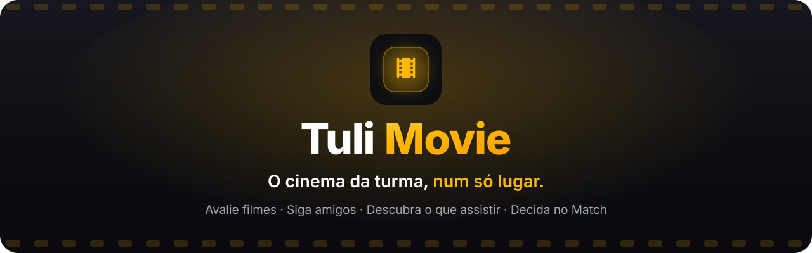

<br />

<a href="https://tulimovie.web.app"></a>

<br /><br />


<br /><br />

**[O que é](#-o-que-é-o-tulimovie)** ·
**[Funcionalidades](#-funcionalidades)** ·
**[Telas](#-telas)** ·
**[Como funciona](#-como-funciona-por-dentro)** ·
**[Rodar o projeto](#-rodando-o-projeto)**

</div>

<br />

## 🍿 O que é o TuliMovie?

O **TuliMovie** é uma rede social de cinema para assistir **com os amigos**.

Assistiu um filme? Você dá a sua nota respondendo **5 perguntas rápidas**, marca quem estava com você e publica. Seus amigos veem no feed, reagem, comentam e marcam outras pessoas. Quando ninguém consegue decidir o que assistir, a turma entra no **Match**: cada um dá *swipe* nos filmes e o primeiro que **todos** curtirem é o escolhido.

> 💡 **Em uma frase:** é um Letterboxd feito para a sua turma, com Tinder de filmes embutido.

Funciona direto no navegador e pode ser **instalado na tela inicial** do iPhone ou do Android como um app (PWA). Não precisa passar por loja de aplicativos.

<br />

<div align="center">
  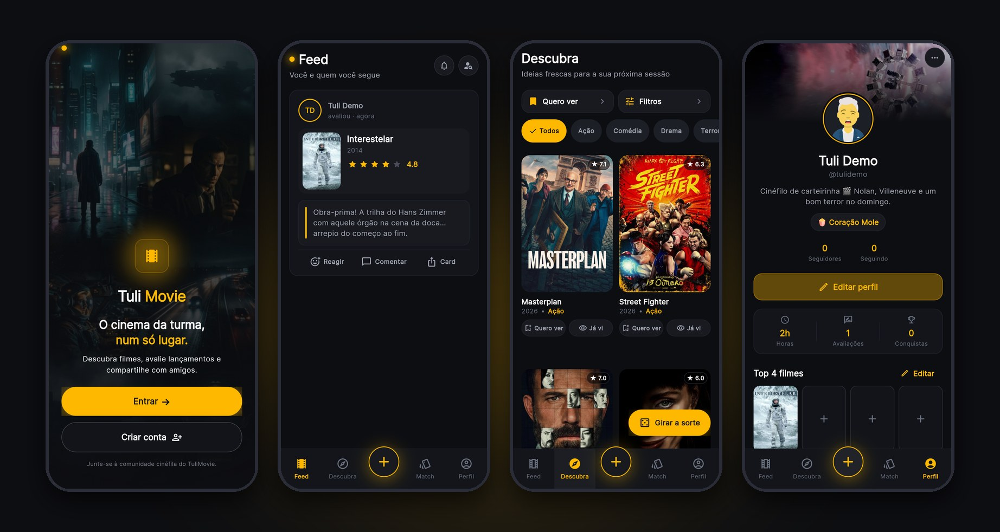
</div>

<br />

## ✨ Funcionalidades

<table>
  <tr>
    <td width="50%" valign="top">
      <h3>⭐ Avaliação em 5 perguntas</h3>
      Nada de nota "no chute". Você avalia <b>Enredo</b>, <b>Atuação</b>, <b>Visual</b>, <b>Trilha sonora</b> e <b>Diversão</b>, e o app calcula a sua nota final. Dá para marcar quem assistiu com você e esconder spoilers com desfoque automático.
    </td>
    <td width="50%" valign="top">
      <h3>📰 Feed social</h3>
      Siga pessoas (estilo Instagram) e veja as avaliações delas. Reaja com figurinhas (😴 😭 🎬 🌽), comente e marque amigos com <code>@</code>. Quando as notas da turma divergem muito, o post ganha o 🔥 <b>Selo da Discórdia</b>.
    </td>
  </tr>
  <tr>
    <td width="50%" valign="top">
      <h3>🧭 Descubra</h3>
      Uma vitrine que mistura lançamentos, clássicos e pérolas escondidas. Tem filtros por gênero, streaming, época e nota. Marque "Já vi" ou "Quero ver" com um toque, ou deixe o botão <b>Girar a sorte</b> escolher por você.
    </td>
    <td width="50%" valign="top">
      <h3>💘 Match de filmes</h3>
      Convide amigos para uma sala, escolha os filtros e todo mundo dá <i>swipe</i> ao mesmo tempo. O app já tira os filmes que alguém da sala viu. Quando <b>todos</b> curtem o mesmo filme, é Match! 🎉
    </td>
  </tr>
  <tr>
    <td width="50%" valign="top">
      <h3>👤 Perfil de cinéfilo</h3>
      Avatar, bio, <b>Top 4 filmes</b> e <b>Top 4 atores</b>, horas assistidas, conquistas (🧟 Sobrevivente, 🦉 Corujão, 🎬 Maratonista…) e um rótulo que mostra o seu estilo: <i>Coração Mole</i>, <i>Equilibrado</i> ou <i>Crítico da Folha</i>.
    </td>
    <td width="50%" valign="top">
      <h3>🏆 Tuli Awards</h3>
      A sua retrospectiva do ano em slides, estilo <i>Stories</i>: quantos filmes você viu, o seu Top 5, a sua nota média e o ranking de <b>quem mais assistiu com você</b>. No final tem uma votação cômica (Pior Filme, Maior Decepção…).
    </td>
  </tr>
  <tr>
    <td width="50%" valign="top">
      <h3>🎬 Ficha completa do filme</h3>
      Sinopse, elenco, direção e <b>onde assistir no Brasil</b> (Netflix, Prime, Max…). Também mostra as avaliações de quem você segue. Toque em um ator para ver a filmografia dele.
    </td>
    <td width="50%" valign="top">
      <h3>📤 Card para Stories &amp; 🔔 notificações</h3>
      Transforme qualquer avaliação em uma imagem 9:16 pronta para postar. Você recebe um aviso quando alguém te segue, comenta, te menciona ou te chama para um Match.
    </td>
  </tr>
</table>

<br />

## 📱 Telas

> Prints reais do app rodando em um celular (390 × 844).

<table>
  <tr>
    <td align="center"><b>Boas-vindas</b></td>
    <td align="center"><b>Entrar</b></td>
    <td align="center"><b>Feed</b></td>
  </tr>
  <tr>
    <td>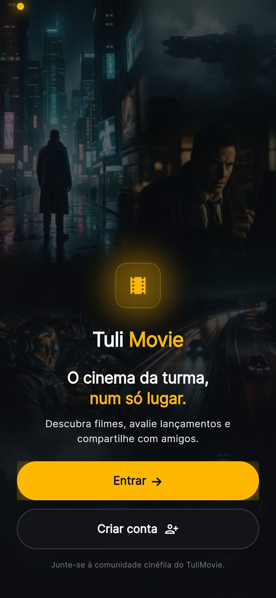</td>
    <td>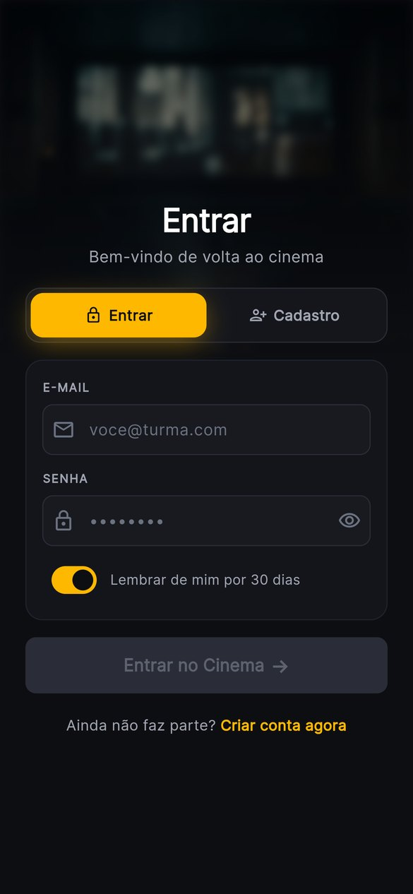</td>
    <td>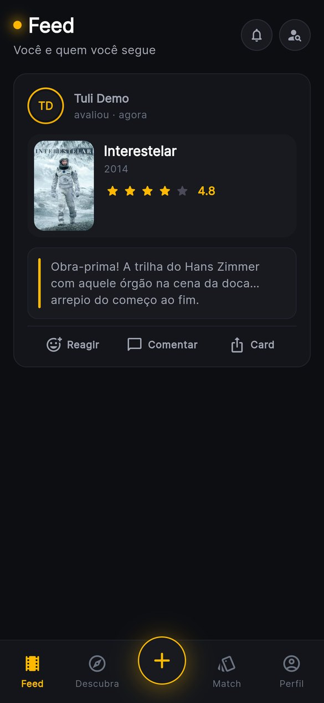</td>
  </tr>
  <tr>
    <td align="center"><b>Descubra</b></td>
    <td align="center"><b>Buscar para avaliar</b></td>
    <td align="center"><b>Ficha do filme</b></td>
  </tr>
  <tr>
    <td>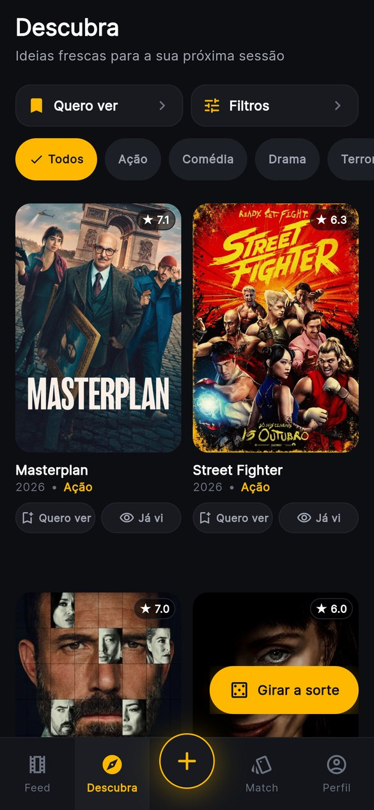</td>
    <td>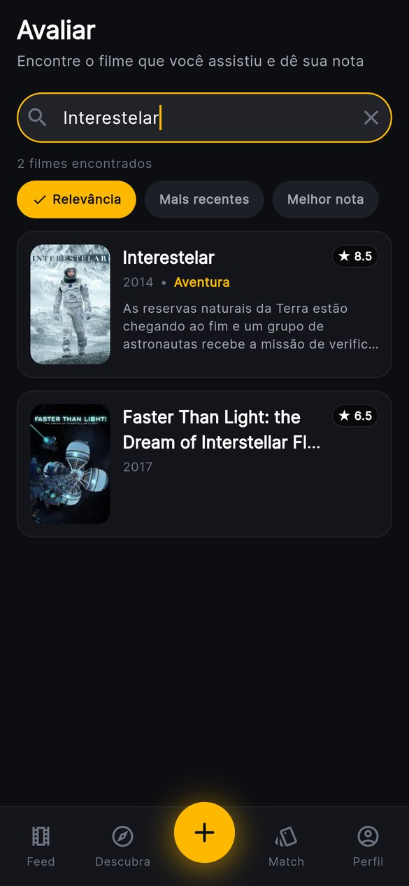</td>
    <td>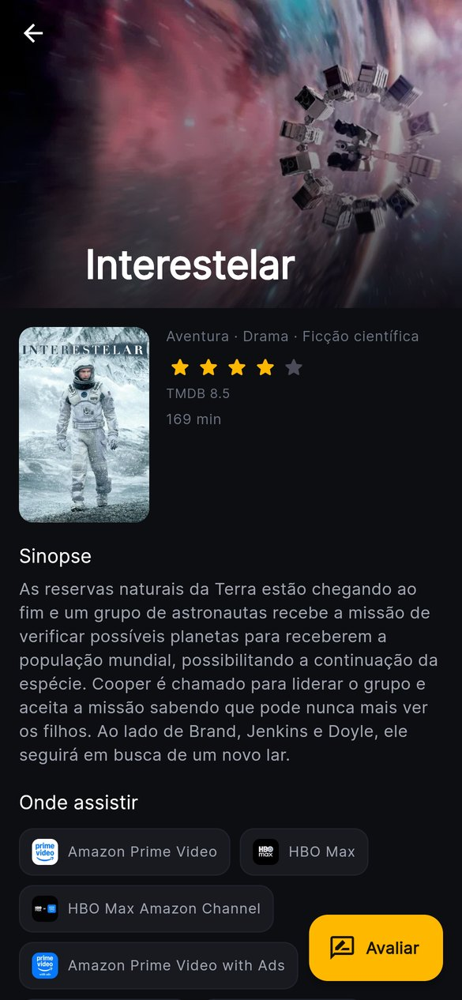</td>
  </tr>
  <tr>
    <td align="center"><b>As 5 perguntas</b></td>
    <td align="center"><b>Comentário &amp; spoiler</b></td>
    <td align="center"><b>Match</b></td>
  </tr>
  <tr>
    <td>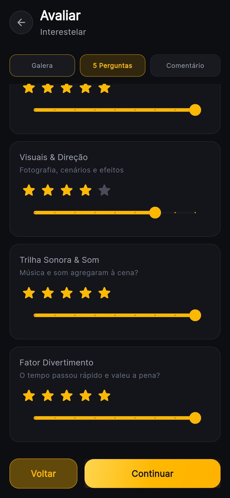</td>
    <td>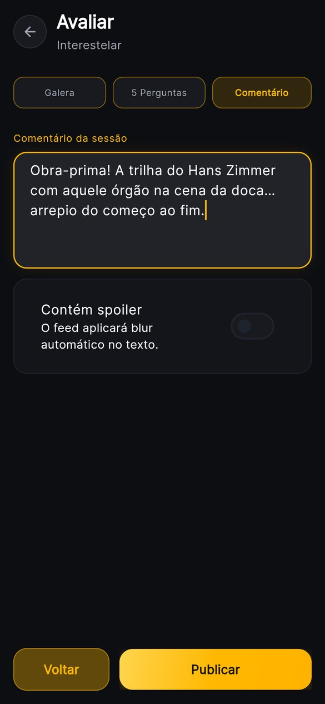</td>
    <td>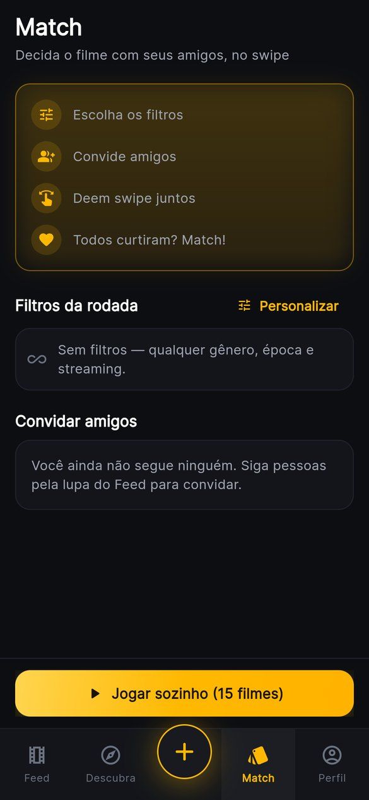</td>
  </tr>
  <tr>
    <td align="center"><b>Swipe</b></td>
    <td align="center"><b>Perfil</b></td>
    <td align="center"><b>Editar perfil</b></td>
  </tr>
  <tr>
    <td>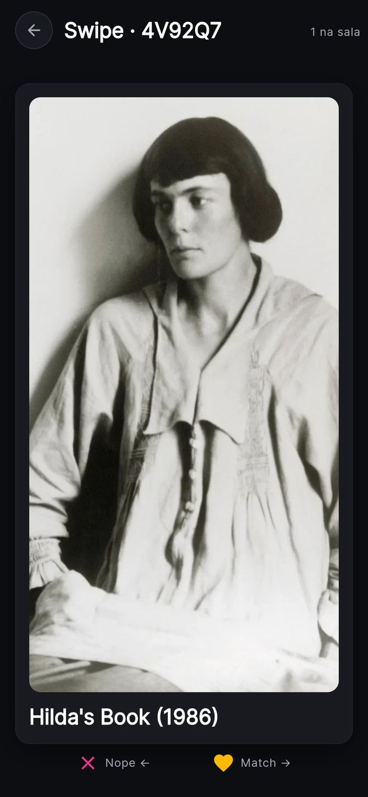</td>
    <td>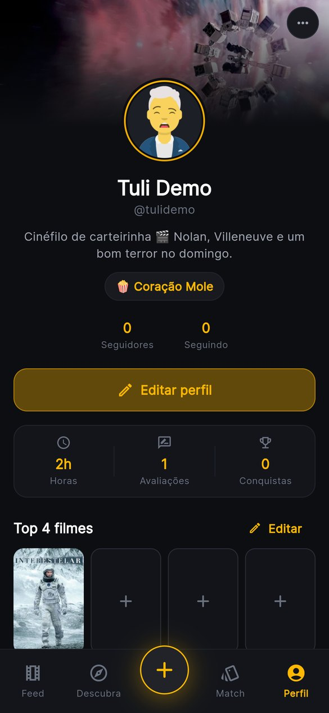</td>
    <td>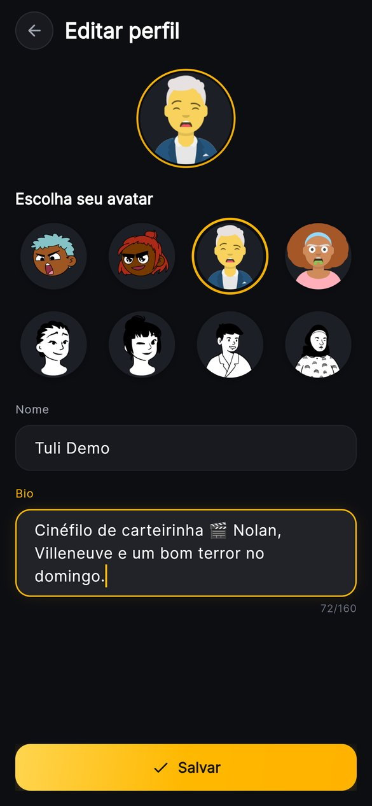</td>
  </tr>
</table>

<br />

## 🔍 Como funciona (por dentro)

<details open>
<summary><b>A nota de uma avaliação</b></summary>

<br />

Cada pergunta vale de 1 a 5 estrelas (com meia estrela). A nota final é a **média das 5 respostas**. Os amigos marcados entram como "assistiu com". Se as notas de quem assistiu junto ficarem **1,5 estrela ou mais** distantes, o post recebe o 🔥 **Selo da Discórdia**.

</details>

<details>
<summary><b>Quem vê o meu post?</b></summary>

<br />

Na hora de publicar, o post é entregue a você e a **quem te segue naquele momento**. Quem começar a te seguir depois vê as suas avaliações no seu perfil, mas não recebe os posts antigos no feed. Se você deixar de seguir alguém, os posts dessa pessoa somem do seu feed. Todos os perfis são públicos.

</details>

<details>
<summary><b>Como o Match escolhe os filmes?</b></summary>

<br />

O app busca no TMDB uma mistura de clássicos bem avaliados e lançamentos recentes que respeitam os filtros da rodada. Se você quiser, inclui também a sua watchlist. Depois, **remove tudo o que alguém da sala já assistiu** e sorteia 15 filmes. Jogando sozinho, o primeiro ❤️ já é Match. Em grupo, o Match só sai quando é **unânime**.

</details>

<br />

## 🛠️ Tecnologias

| Camada | O que usamos |
|---|---|
| **App** | [Flutter](https://flutter.dev) (Web/PWA + Android) com Material 3 e a fonte Inter |
| **Estado** | [Riverpod](https://riverpod.dev) + injeção de dependências com [get_it](https://pub.dev/packages/get_it) |
| **Login** | Firebase Authentication (e-mail e senha + @username único) |
| **Banco de dados** | Cloud Firestore, protegido pelas regras de [`firestore.rules`](firestore.rules) |
| **Notificações** | Avisos dentro do app (Firestore) |
| **Filmes** | [TMDB API](https://www.themoviedb.org/documentation/api) via [Dio](https://pub.dev/packages/dio), com cache em memória |
| **Hospedagem** | Firebase Hosting, no plano **Spark** (gratuito, sem Cloud Functions) |
| **Extras** | `flutter_card_swiper` (Match), `lottie` (comemoração), `screenshot` + `share_plus` (card para Stories) |

<br />

## 🧱 Arquitetura

O código segue **Clean Architecture organizada por funcionalidade** (*feature-first*). Cada funcionalidade é dividida em três camadas, e as dependências sempre apontam para dentro:

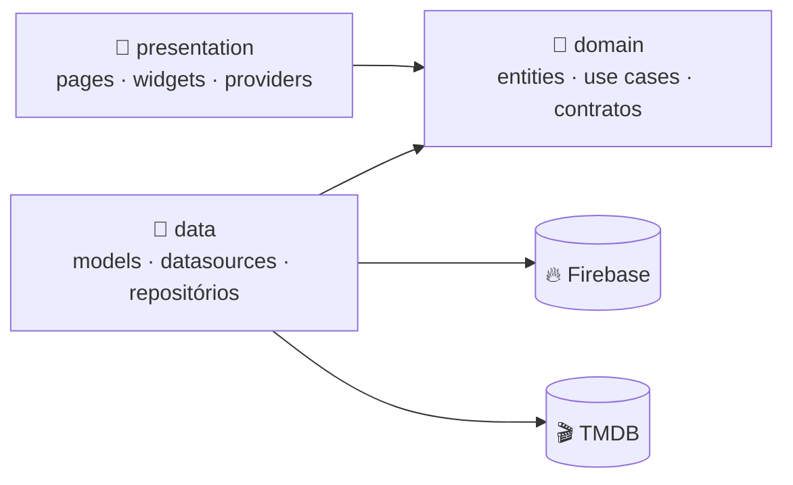

```
lib/
├── main.dart · app.dart
├── core/                 # Base compartilhada
│   ├── config/           #   Firebase, variáveis de ambiente
│   ├── di/               #   Injeção de dependências (get_it)
│   ├── network/          #   Cliente HTTP (Dio) + cache + erros
│   ├── presentation/     #   Design system: TuliButton, TuliCard, …
│   └── theme/            #   Cores, tipografia, espaçamentos
└── features/
    ├── auth/             # Login, cadastro e @username
    ├── feed/             # Feed social, reações, Selo da Discórdia
    ├── reviews/          # Fluxo de avaliação (5 perguntas)
    ├── comments/         # Comentários e @menções
    ├── social/           # Seguir, busca de pessoas, perfil público
    ├── notifications/    # Central de notificações
    ├── discover/         # Vitrine de sugestões e filtros
    ├── movies/           # Busca, ficha do filme e do ator (TMDB)
    ├── movie_match/      # Salas de Match e swipe
    ├── tools/            # Watchlist e roleta
    ├── profile/          # Perfil, Top 4, conquistas
    ├── awards/           # Tuli Awards (retrospectiva)
    ├── share/            # Card 9:16 para Stories
    └── shell/            # Navegação principal (abas)
```

<details>
<summary><b>📂 Como os dados ficam no Firestore</b></summary>

<br />

| Coleção | Para que serve |
|---|---|
| `users/{uid}` | Perfil público: nome, @, avatar, bio e Top 4 |
| `users/{uid}/following` · `followers` | Quem a pessoa segue e quem segue a pessoa (espelhados) |
| `users/{uid}/watchlist` · `watched` | Lista "Quero ver" e filmes marcados como "Já vi" |
| `users/{uid}/notifications` | Caixa de entrada de avisos |
| `usernames/{username}` | Garante que cada @ seja único |
| `reviews/{id}` | Avaliações (com `audienceIds`, quem recebe o post no feed) |
| `reviews/{id}/comments` | Comentários e menções |
| `matches/{id}` + `/swipes` | Salas de Match e os votos de cada participante |
| `awards/{ano}/votes` | Votação cômica do Tuli Awards |

</details>

<br />

## 🚀 Rodando o projeto

### Pré-requisitos

- [Flutter](https://docs.flutter.dev/get-started/install) 3.x (Dart 3.5 ou mais novo)
- Uma conta no [TMDB](https://www.themoviedb.org/settings/api) para pegar a **API Key (v3)**
- Um projeto no [Firebase](https://console.firebase.google.com) com **Authentication (e-mail/senha)** e **Firestore** ativados

### Passo a passo

**1. Clone e instale as dependências**

```bash
git clone https://github.com/Nickvtj/TuliMovie.git
cd TuliMovie
flutter pub get
```

**2. Configure as chaves.** Copie o arquivo de exemplo e preencha a sua chave do TMDB:

```bash
cp dart_defines.example.json dart_defines.json
```

```json
{
  "TMDB_API_KEY": "sua_api_key_v3"
}
```

> ⚠️ Use a **API Key (v3)**, não o *Read Access Token* (JWT). O `dart_defines.json` fica só na sua máquina e não vai para o Git.

**3. Rode no Chrome**

| Onde | Comando |
|---|---|
| Windows (CMD) | `run.cmd` |
| Git Bash / Linux / macOS | `./run.sh` |
| VS Code / Cursor | **F5**, configuração *TuliMovie (Chrome + TMDB)* |
| Manual | `flutter run -d chrome --dart-define-from-file=dart_defines.json` |

> 🔥 Vai usar o seu próprio Firebase? Siga o passo a passo em [`docs/FIREBASE_SETUP.md`](docs/FIREBASE_SETUP.md) para gerar o `firebase_options.dart` e publicar as regras e os índices do Firestore.

### 🧪 Testes

```bash
flutter test
```

Os testes cobrem as regras de negócio: cálculo das notas, Selo da Discórdia, consenso do Match, Tuli Awards, validação de @username, menções, modelos e mais.

### 📦 Publicar

O build da versão web (PWA) e o deploy no Firebase Hosting estão em [`docs/RELEASE.md`](docs/RELEASE.md):

```powershell
.\scripts\build_release.ps1   # gera build/web
.\scripts\deploy_web.ps1      # publica no Firebase Hosting
```

<br />

## 🎨 Identidade visual

<table>
  <tr>
    <td align="center"><br /><sub>Fundo</sub></td>
    <td align="center"><br /><sub>Superfície</sub></td>
    <td align="center"><br /><sub>Dourado</sub></td>
    <td align="center"><br /><sub>Neon (Discórdia)</sub></td>
    <td align="center"><br /><sub>Texto secundário</sub></td>
  </tr>
</table>

Tema escuro de sala de cinema, com detalhes em dourado e a fonte **Inter**. Todos os tokens de cor, espaçamento e forma ficam em [`lib/core/theme`](lib/core/theme).

<br />

## 🙏 Créditos

<a href="https://www.themoviedb.org"></a>

Dados e imagens de filmes fornecidos pelo [TMDB](https://www.themoviedb.org). *Este produto usa a API do TMDB, mas não é endossado nem certificado pelo TMDB.* Os avatares são gerados pelo [DiceBear](https://www.dicebear.com).

<br />

<div align="center">

Feito com 🍿 e muito café por **[@Nickvtj](https://github.com/Nickvtj)**

<sub>Gostou? Deixa uma ⭐ no repositório!</sub>

</div>
